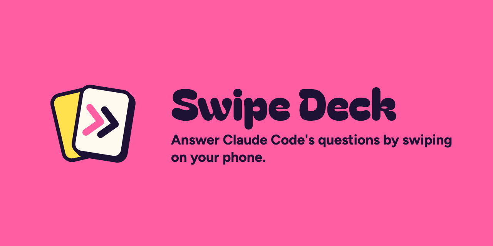

<p align="center"></p>

# Swipe Deck

Answer Claude Code's questions by swiping cards on your phone, instead of typing in the terminal. Run `/swipe:swipe`, open one private page, swipe, and Claude carries on by itself.

## Install

```text
/plugin install swipe --marketplace tunmin11/swipe-deck
```

## Use it

1. Run `/swipe:swipe` with what you're deciding, such as `/swipe:swipe how should we build login`.
2. Open the link on your phone. It's the same page every time, so keep it handy.
3. Swipe through the cards and tap "lock it in".

Claude picks up your answers within about a minute. Use Remote Control if you want to see the same chat on your phone.

## Requirements

- Claude Code signed in with `/login` on a plan with artifacts: Pro, Max, Ultra, Team or Enterprise
- API key, Bedrock and Vertex sessions can't publish artifacts
- Team and Enterprise owners can turn artifacts off
- An interactive session, because `claude -p` doesn't have the artifact tools

## Privacy

Your cards and answers are stored in a private artifact on claude.ai, and they stay there until you delete the page. Only you can read or change them, unless you change the page's code. Team and Enterprise admins can read artifacts through the compliance API.

## Cost

While waiting for you, Claude checks for your answers with a short turn in your conversation. Each check uses your plan's usage, and costs more in a long conversation. Claude stops checking after 15 minutes and asks you to say done.

## Limits

- Cards are two-way choices, so decisions with more options may stay in the terminal
- The page can't close itself after you lock in
- Unfinished decks stay on the page's picker

## Docs

- [Beta guide](docs/beta-guide.md)
- [Troubleshooting](docs/troubleshooting.md)
- [Changelog](CHANGELOG.md)

Found a problem? [Send beta feedback](https://github.com/tunmin11/swipe-deck/issues/new?template=beta-feedback.md).

## License

MIT
